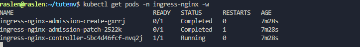
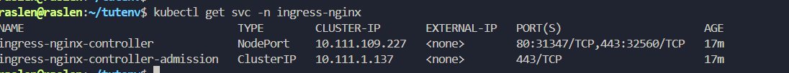
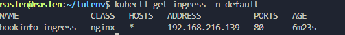

# 1. Ingress NGINX with a NodePort (HTTP)

Expose the Bookinfo application through the NGINX Ingress Controller on a local cluster, without any load balancer. Traffic enters on a NodePort of the node.

**Result:** `http://<node IP>:<NodePort>/productpage` serves Bookinfo.

## Before you start

- A working cluster (kubeadm, Kind or Minikube).
- If the controller will run on the control plane node, remove its `NoSchedule` taint.
- Bookinfo deployed in the `default` namespace (same manifest as Istio 1.26.0):

  ```bash
  kubectl apply -f https://raw.githubusercontent.com/istio/istio/1.26.0/samples/bookinfo/platform/kube/bookinfo.yaml
  ```

## Steps

**1. Install the controller** (bare-metal manifest, which creates a NodePort Service):

```bash
kubectl apply -f https://raw.githubusercontent.com/kubernetes/ingress-nginx/controller-v1.10.0/deploy/static/provider/baremetal/deploy.yaml
```

**2. Wait for the controller pod.** The `ingress-nginx-admission-create` and `-patch` jobs end as `Completed`; `ingress-nginx-controller` must be `Running` and `1/1`:

```bash
kubectl get pods -n ingress-nginx -w
```



**3. Note the NodePort** of the `ingress-nginx-controller` Service (for example `80:31347/TCP`):

```bash
kubectl get svc -n ingress-nginx
```



**4. Create the Ingress** that routes `/productpage` to the `productpage` Service on port 9080 ([bookinfo-ingress.yaml](bookinfo-ingress.yaml)):

```bash
kubectl apply -f 01-ingress-nodeport/bookinfo-ingress.yaml
kubectl get ingress -n default
```



**5. Open the application.** Get the node IP with `hostname -I | awk '{print $1}'`, then browse to:

```text
http://<node IP>:<NodePort>/productpage      e.g. http://192.168.216.141:31347/productpage
```

**Limit:** the URL carries a high port number. [Stage 3](../03-ingress-metallb/) removes it with MetalLB.
