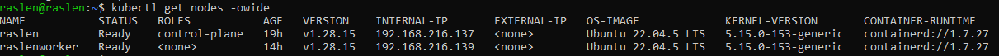
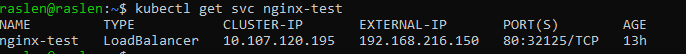
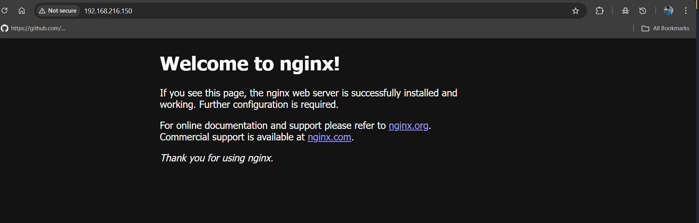

# 2. MetalLB: LoadBalancer Services on bare metal

On a cloud provider, a Service of type `LoadBalancer` gets an external IP automatically. On a local or bare-metal cluster there is nothing to provide it, so the `EXTERNAL-IP` stays `<pending>`. MetalLB fills that gap: it hands out IPs from a range of your LAN and announces them in Layer 2 mode.

**Result:** a `LoadBalancer` Service gets an IP from the pool and answers on port 80.

## Before you start

- A cluster with at least one control plane node and one worker.
- A range of **free** IPs in the **same subnet** as the nodes. Check the node IPs:

  ```bash
  kubectl get nodes -o wide
  ```

  

  With nodes on `192.168.216.x`, this lab uses `192.168.216.150-192.168.216.160`.

## Steps

**1. Install MetalLB v0.15.2.** The `memberlist` Secret secures the traffic between the controller and the speakers; creating it first avoids `CrashLoopBackOff` at start-up.

```bash
kubectl create ns metallb-system
kubectl create secret generic -n metallb-system memberlist --from-literal=secretkey="$(openssl rand -base64 128)"
kubectl apply -f https://raw.githubusercontent.com/metallb/metallb/v0.15.2/config/manifests/metallb-native.yaml
kubectl get pods -n metallb-system -w   # controller and speakers Running, 0 restarts
```

**2. Define the IP pool and announce it in Layer 2.** Edit the range in [ipaddresspool.yaml](ipaddresspool.yaml) to match your network first.

```bash
kubectl apply -f 02-metallb/ipaddresspool.yaml
kubectl apply -f 02-metallb/l2advertisement.yaml
kubectl get ipaddresspool,l2advertisement -n metallb-system
```

**3. Test with a LoadBalancer Service.** The `EXTERNAL-IP` must come from the pool:

```bash
kubectl create deployment nginx-test --image=nginx
kubectl expose deployment nginx-test --type=LoadBalancer --port=80
kubectl get svc nginx-test
```



**4. Open the IP** from any machine on the LAN, for example `curl http://192.168.216.150`. The nginx welcome page appears:



## Clean up

```bash
kubectl delete svc,deployment nginx-test
kubectl delete -f 02-metallb/l2advertisement.yaml -f 02-metallb/ipaddresspool.yaml
kubectl delete -f https://raw.githubusercontent.com/metallb/metallb/v0.15.2/config/manifests/metallb-native.yaml
```

Deleting the manifest also removes the `metallb-system` namespace and the `memberlist` Secret.
