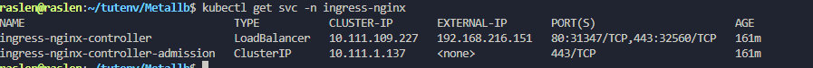
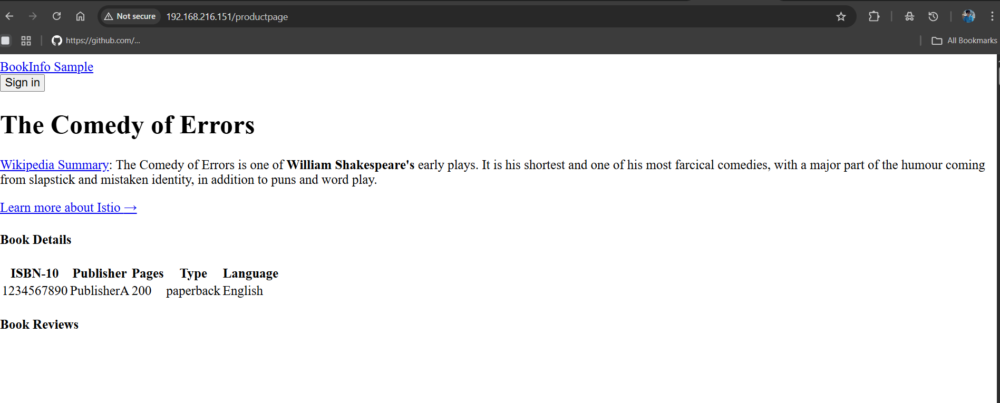
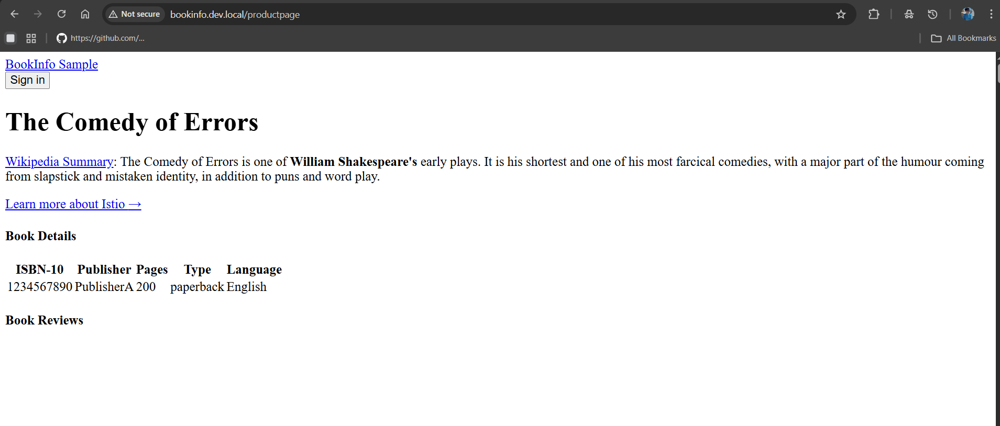

# 3. Ingress NGINX behind MetalLB (HTTP)

Same Ingress as [stage 1](../01-ingress-nodeport/), but the controller Service becomes a `LoadBalancer` and gets a stable IP from MetalLB. No more port in the URL.

**Result:** `http://192.168.216.151/productpage`, then `http://bookinfo.kube.local/productpage`.

## Before you start

- MetalLB installed with an IP pool ([stage 2](../02-metallb/)).
- Bookinfo deployed in `default` ([stage 1](../01-ingress-nodeport/#before-you-start)).

## Steps

**1. Install the controller** (skip if stage 1 is still in place):

```bash
kubectl apply -f https://raw.githubusercontent.com/kubernetes/ingress-nginx/controller-v1.10.0/deploy/static/provider/baremetal/deploy.yaml
kubectl get pods -n ingress-nginx -w
```

**2. Switch the controller Service to `LoadBalancer`.** The bare-metal manifest creates a NodePort; once patched, MetalLB assigns it an IP from the pool:

```bash
kubectl patch svc ingress-nginx-controller -n ingress-nginx -p '{"spec": {"type": "LoadBalancer"}}'
kubectl get svc -n ingress-nginx -w
```



**3. Apply the Ingress** (same file as stage 1):

```bash
kubectl apply -f 01-ingress-nodeport/bookinfo-ingress.yaml
kubectl get ingress -n default
```

**4. Open the application** on the controller's external IP:

```text
http://<EXTERNAL-IP>/productpage      e.g. http://192.168.216.151/productpage
```



## Use a host name

- **Real domain:** create an `A` record (for example `bookinfo.example.com`) pointing to the controller's external IP.
- **Local test, no domain:** map a test name to the IP in the hosts file, `/etc/hosts` on Linux or `C:\Windows\System32\drivers\etc\hosts` on Windows:

  ```text
  192.168.216.151   bookinfo.kube.local
  ```



This host name is the one secured with HTTPS in [stage 4](../04-self-signed-tls/).
