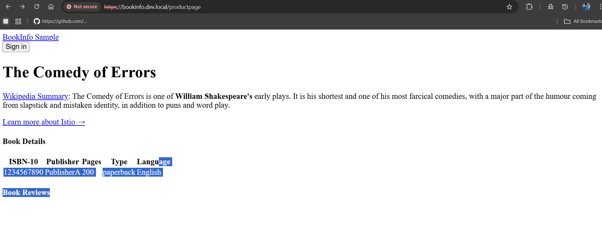

# 4. HTTPS with a self-signed certificate

Generate a certificate with OpenSSL, store it in a Kubernetes TLS Secret, and let the Ingress terminate HTTPS. The browser still warns, because no trusted authority signed the certificate; [stage 6](../06-letsencrypt/) fixes that with Let's Encrypt.

**Result:** `https://bookinfo.kube.local/productpage` served over HTTPS (after accepting the browser warning).

## Before you start

- [Stage 3](../03-ingress-metallb/) done: controller behind MetalLB, Bookinfo Ingress applied, and `bookinfo.kube.local` in your hosts file.

## Steps

**1. Generate the key and the certificate.** [san.cnf](san.cnf) puts the domain both in the Common Name and in the Subject Alternative Name, which browsers require. Change `bookinfo.kube.local` in it if you use another name.

```bash
cd 04-self-signed-tls
export DOMAIN_NAME="bookinfo.kube.local"
openssl req -x509 -sha256 -nodes -days 365 -newkey rsa:2048 \
  -keyout "$DOMAIN_NAME.key" -out "$DOMAIN_NAME.crt" \
  -config san.cnf -extensions req_ext
```

| Option | Meaning |
|---|---|
| `-x509` | output a self-signed certificate instead of a signing request |
| `-sha256` | sign with SHA-256 |
| `-nodes` | do not encrypt the private key (no passphrase, lab only) |
| `-days 365` | valid for one year |
| `-newkey rsa:2048` | create a new 2048-bit RSA key |
| `-config san.cnf -extensions req_ext` | take the subject and the SAN from `san.cnf` |

The `.key` and `.crt` files are git-ignored.

**2. Store them in a TLS Secret:**

```bash
kubectl create secret tls bookinfo-tls --cert="$DOMAIN_NAME.crt" --key="$DOMAIN_NAME.key" -n default
kubectl get secret bookinfo-tls -n default
```

**3. Add the `tls` section to the Ingress** ([bookinfo-ingress-tls.yaml](bookinfo-ingress-tls.yaml)) and apply it:

```bash
kubectl apply -f bookinfo-ingress-tls.yaml
```

**4. Restart the controller** so it loads the certificate right away:

```bash
kubectl delete pod -n ingress-nginx -l app.kubernetes.io/component=controller
```

**5. Open `https://bookinfo.kube.local/productpage`** and accept the warning. The page loads over HTTPS:


