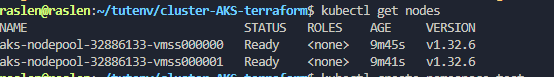
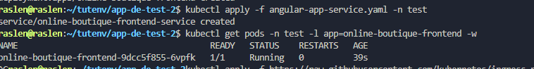
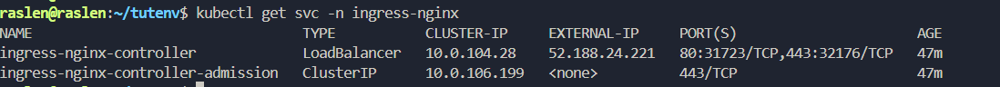
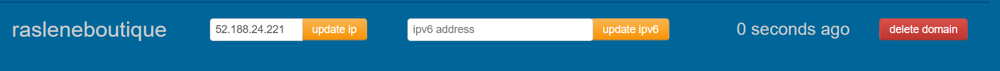
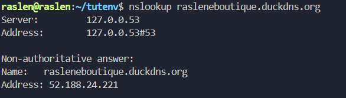
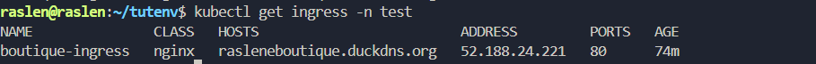
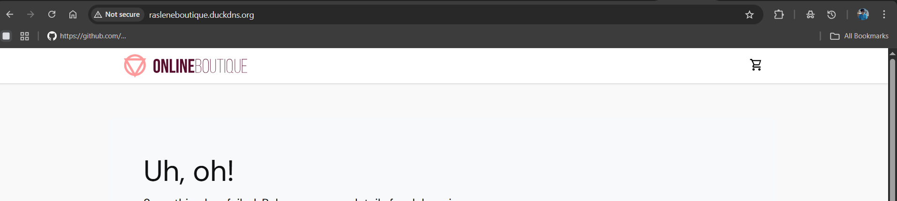

# 5. Public Ingress on Azure AKS with a domain name (HTTP)

Create an AKS cluster with Terraform, expose an application through the NGINX Ingress Controller on a public Azure IP, and reach it with a free DuckDNS domain.

**Result:** `http://rasleneboutique.duckdns.org/` serves the Online Boutique frontend from AKS.

## Before you start

- Azure CLI installed and logged in (`az login`), Terraform 1.1 or newer.
- An SSH public key at `~/.ssh/id_rsa.pub` (used for the AKS nodes).

## Steps

**1. Create the cluster** ([terraform/main.tf](terraform/main.tf): resource group `rg-raslen-cert` in East US, AKS `raslen-cert-aks` with 2 `Standard_B2ms` nodes) and connect `kubectl` to it:

```bash
cd 05-aks-ingress/terraform
terraform init && terraform plan
terraform apply --auto-approve
az aks get-credentials --resource-group rg-raslen-cert --name raslen-cert-aks
cd ../..
kubectl get nodes
```



**2. Deploy the application** (Online Boutique frontend `v0.9.0`, ClusterIP Service on port 80):

```bash
kubectl create ns test
kubectl apply -f 05-aks-ingress/app/ -n test
kubectl get pods -n test -l app=online-boutique-frontend
```



**3. Install the controller** with the **cloud** manifest: its Service is a `LoadBalancer`, and Azure gives it a public IP.

```bash
kubectl apply -f https://raw.githubusercontent.com/kubernetes/ingress-nginx/controller-v1.10.0/deploy/static/provider/cloud/deploy.yaml
kubectl get svc -n ingress-nginx -w      # wait for the EXTERNAL-IP
```



**4. Point a domain to that IP.** On [duckdns.org](https://www.duckdns.org), create a subdomain (here `rasleneboutique`), set its IP to the controller's external IP and click **update ip**:



Check that the name resolves to that IP:

```bash
nslookup rasleneboutique.duckdns.org
```



**5. Open ports 80 and 443** in the Network Security Group of the AKS nodes, otherwise Internet traffic never reaches the controller:

```bash
NODE_RG_NAME=$(az aks show --resource-group rg-raslen-cert --name raslen-cert-aks --query nodeResourceGroup -o tsv)
NSG_NAME=$(az network nsg list --resource-group "$NODE_RG_NAME" --query "[0].name" -o tsv)

az network nsg rule create --resource-group "$NODE_RG_NAME" --nsg-name "$NSG_NAME" \
  --name AllowHTTPInbound --priority 1000 --direction Inbound --access Allow --protocol Tcp \
  --source-address-prefixes Internet --destination-port-ranges 80

az network nsg rule create --resource-group "$NODE_RG_NAME" --nsg-name "$NSG_NAME" \
  --name AllowHTTPSInbound --priority 1001 --direction Inbound --access Allow --protocol Tcp \
  --source-address-prefixes Internet --destination-port-ranges 443
```

**6. Create the Ingress** for the domain ([boutique-ingress.yaml](boutique-ingress.yaml); replace the host with yours):

```bash
kubectl apply -f 05-aks-ingress/boutique-ingress.yaml
kubectl get ingress -n test -w           # wait for the ADDRESS
```



If the site does not answer yet, restart the controller: `kubectl delete pod -n ingress-nginx -l app.kubernetes.io/component=controller`.

**7. Open `http://rasleneboutique.duckdns.org/`:**



## Clean up

```bash
cd 05-aks-ingress/terraform && terraform destroy
```
