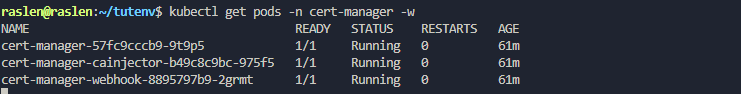
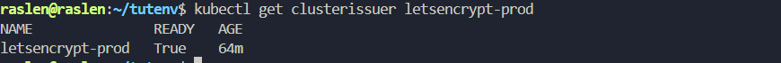
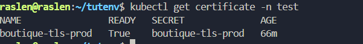
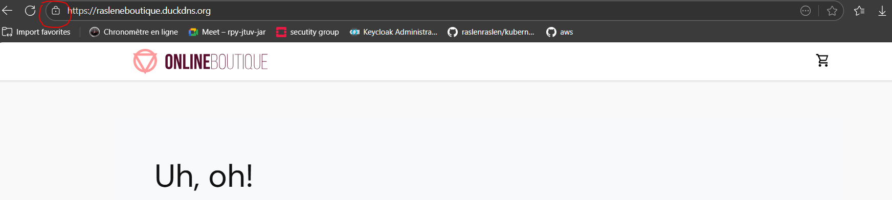

# 6. Trusted HTTPS with Let's Encrypt and cert-manager

Install cert-manager on AKS, let it obtain a production certificate from Let's Encrypt (HTTP-01 challenge), and serve the site over HTTPS with no browser warning. cert-manager also renews the certificate before it expires.

**Result:** `https://rasleneboutique.duckdns.org/` with a trusted padlock, and HTTP redirected to HTTPS.

## Before you start

- [Stage 5](../05-aks-ingress/) done: the site answers over HTTP on its public domain, and ports 80 and 443 are open. Let's Encrypt validates the domain by calling it on port 80.

## Steps

**1. Install cert-manager v1.12.0.** The CRDs (`ClusterIssuer`, `Certificate`, ...) must exist before the components that use them:

```bash
kubectl create namespace cert-manager
kubectl apply -f https://github.com/cert-manager/cert-manager/releases/download/v1.12.0/cert-manager.crds.yaml
kubectl apply -f https://github.com/cert-manager/cert-manager/releases/download/v1.12.0/cert-manager.yaml
kubectl get pods -n cert-manager -w      # cert-manager, cainjector and webhook Running 1/1
```



**2. Create the ClusterIssuer** for Let's Encrypt production. Set a valid e-mail in [letsencrypt-prod-clusterissuer.yaml](letsencrypt-prod-clusterissuer.yaml) first: Let's Encrypt sends expiry notices to it.

```bash
kubectl apply -f 06-letsencrypt/letsencrypt-prod-clusterissuer.yaml
kubectl get clusterissuer letsencrypt-prod   # READY True
```

A **ClusterIssuer** works for Ingresses in every namespace. It uses the HTTP-01 challenge: Let's Encrypt fetches a token from `http://<your domain>/.well-known/acme-challenge/`, which cert-manager serves through the NGINX Ingress.



**3. Replace the Ingress with its TLS version** ([boutique-ingress-tls.yaml](boutique-ingress-tls.yaml)). The `cert-manager.io/cluster-issuer` annotation makes cert-manager request a certificate for the host and store it in the `boutique-tls-prod` Secret; `force-ssl-redirect` sends HTTP visitors to HTTPS.

```bash
kubectl apply -f 06-letsencrypt/boutique-ingress-tls.yaml
kubectl get certificate -n test -w       # READY True once Let's Encrypt has issued it
```



**4. Restart the controller** so it serves the new certificate right away:

```bash
kubectl delete pod -n ingress-nginx -l app.kubernetes.io/component=controller
```

**5. Open `https://rasleneboutique.duckdns.org/`.** The padlock is closed and there is no security warning:



## If the certificate stays `READY False`

```bash
kubectl describe certificate -n test
kubectl get challenges -n test
```

The usual causes are a DNS record that does not point to the controller IP yet, or port 80 closed in the NSG.
