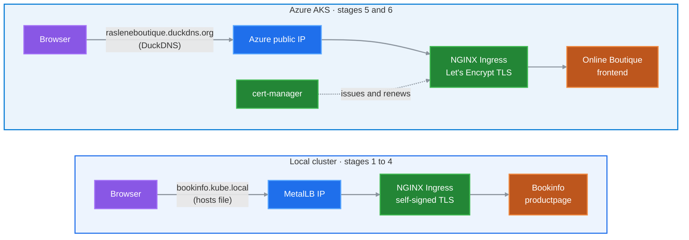

# Kubernetes Ingress and TLS Lab

How to expose an application on Kubernetes and secure it with TLS, in six stages: from a local cluster reached through a NodePort, to a public site on Azure AKS with a trusted Let's Encrypt certificate.
Every stage was run end to end; each guide shows the commands and screenshots of the result.

## The six stages

| # | Stage | Where | You end up with |
|---|---|---|---|
| 1 | [Ingress NGINX with a NodePort](01-ingress-nodeport/) | local | `http://<node IP>:<NodePort>/productpage` |
| 2 | [MetalLB](02-metallb/) | local | `LoadBalancer` Services get an IP from your LAN |
| 3 | [Ingress NGINX behind MetalLB](03-ingress-metallb/) | local | `http://bookinfo.kube.local/productpage` |
| 4 | [HTTPS with a self-signed certificate](04-self-signed-tls/) | local | `https://bookinfo.kube.local`, with a browser warning |
| 5 | [Public Ingress on AKS with a domain](05-aks-ingress/) | Azure | `http://rasleneboutique.duckdns.org` |
| 6 | [Let's Encrypt with cert-manager](06-letsencrypt/) | Azure | `https://rasleneboutique.duckdns.org`, trusted padlock |

Each stage builds on the previous one, so follow them in order. The Azure stages (5 and 6) do not need the local ones.

## Architecture

## What each stage shows

- **Ingress basics:** one controller routes HTTP paths to ClusterIP Services.
- **NodePort vs LoadBalancer:** why bare metal needs MetalLB, and how a Layer 2 IP pool works.
- **DNS:** a hosts-file name for a local lab, a public A record for the cloud.
- **TLS:** how a certificate, its private key and the Subject Alternative Name fit together, and why a self-signed certificate is not trusted.
- **Cloud networking:** the AKS node Network Security Group must allow ports 80 and 443.
- **Automated certificates:** cert-manager solves the Let's Encrypt HTTP-01 challenge, stores the certificate in a Secret and renews it.

## Requirements

- **Stages 1 to 4:** a kubeadm, Kind or Minikube cluster and `kubectl`. For a multi-node kubeadm cluster, see [ansible-kubeadm-cluster](https://github.com/raslenraslen/ansible-kubeadm-cluster).
- **Stages 5 and 6:** an Azure subscription, Azure CLI, Terraform and a free [DuckDNS](https://www.duckdns.org) domain.

Commands are run from the repository root, unless a guide says to `cd` into a folder.

## Versions

| Component | Version |
|---|---|
| ingress-nginx | controller-v1.10.0 |
| MetalLB | v0.15.2 |
| cert-manager | v1.12.0 |
| Bookinfo | Istio 1.26.0 sample |
| Online Boutique frontend | v0.9.0 |
| Terraform provider `azurerm` | ~> 3.0 |
